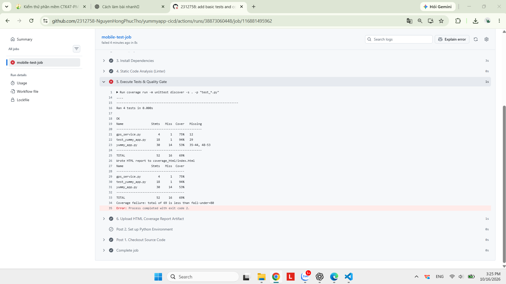
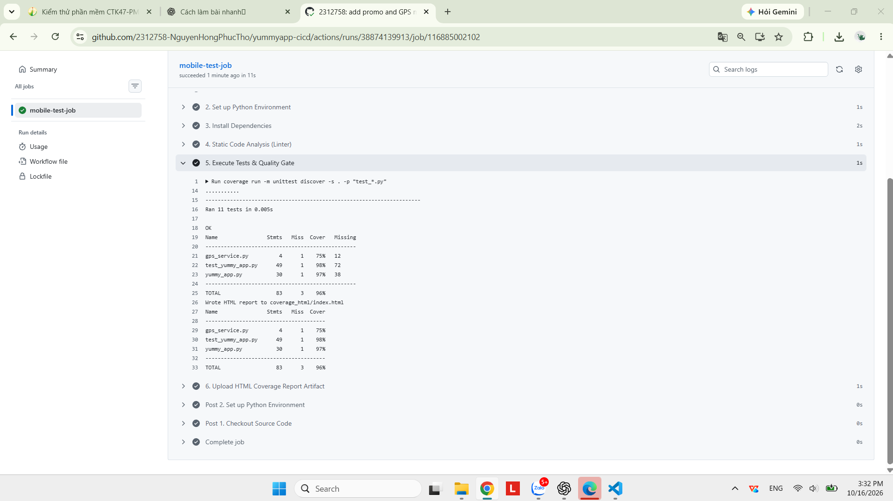
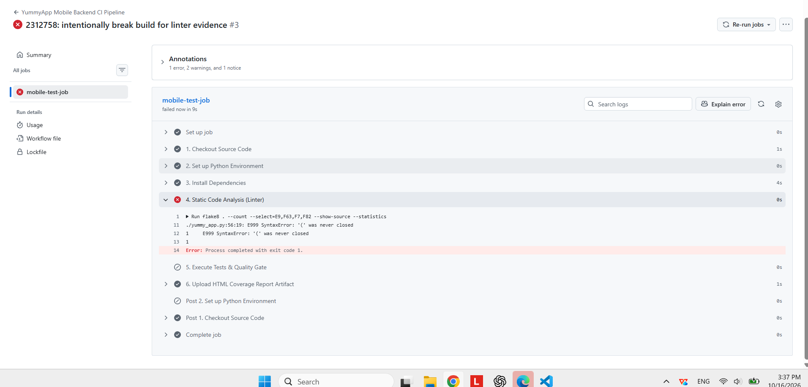
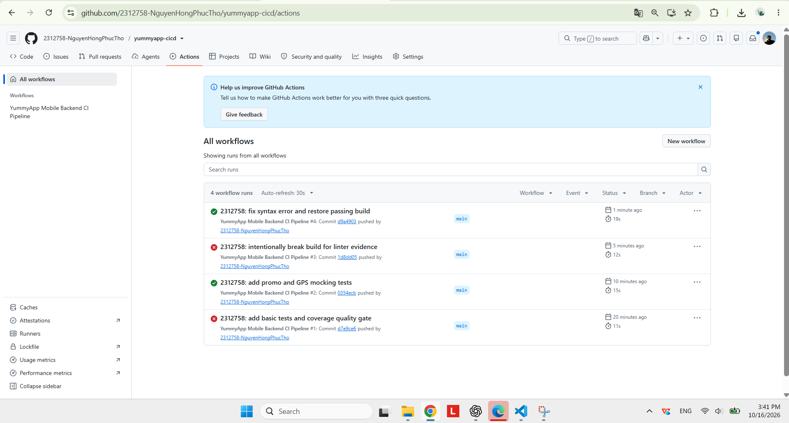

# BÁO CÁO KẾT QUẢ BÀI THỰC HÀNH 7

## 1. Thông tin bài thực hành

- Họ và tên: Nguyễn Hồng Phúc Thọ
- MSSV: 2312758
- Ngày thực hành: 16/10/2026
- Tên bài: Kiểm thử Mocking ứng dụng di động và tích hợp liên tục (CI/CD)

## 2. Mục tiêu

Kiểm thử logic tính tiền, giả lập các trạng thái mạng/GPS, đo độ bao phủ và tự động hóa kiểm tra bằng GitHub Actions với Quality Gate 80%.

## 3. Công cụ và môi trường

- Windows, VS Code, Git và GitHub
- Python 3.11
- `unittest`, `unittest.mock`, Coverage.py 7.4.0 và flake8 7.0.0
- GitHub Actions runner `ubuntu-latest`

## 4. Cấu trúc project

```text
yummyapp-cicd/
├── .github/workflows/yummyapp-ci.yml
├── gps_service.py
├── yummy_app.py
├── test_yummy_app.py
├── requirements.txt
├── logs/
├── README.md
├── HUONG_DAN_VIET_TAY.md
└── BAO_CAO_KY_THUAT.md
```

## 5. Chức năng từng file

- `gps_service.py`: mô phỏng phần cứng GPS và ngoại lệ mất tín hiệu.
- `yummy_app.py`: tính tổng đơn hàng, áp dụng mã giảm giá và tìm nhà hàng gần vị trí.
- `test_yummy_app.py`: chứa 4 test cơ bản, 4 test promo và 3 test GPS dùng mock.
- `requirements.txt`: ghim phiên bản dependency.
- `yummyapp-ci.yml`: chạy linter, test, coverage, Quality Gate và upload HTML artifact.

## 6. Kết quả kiểm thử thực tế

Đã chạy thực tế bằng Python 3.12.14 trong môi trường ảo cục bộ: **11/11 test PASS**. Thời gian lần chạy cuối ghi nhận trong log: **0.014 giây**. GitHub Actions đã kiểm tra lại thành công trên Python 3.11 theo yêu cầu đề bài.

Chi tiết: `logs/local_test.log`.

## 7. Kết quả Coverage

Coverage thực tế đạt **96%** (83 statements, 3 statements chưa chạy), vượt mục tiêu 85% và Quality Gate 80%.

Các dòng chưa được thực thi là phần trả về mặc định của GPS thật, nhánh mã promo không hợp lệ và lệnh `unittest.main()` khi chạy file trực tiếp. Chúng không thuộc bảy kịch bản Mocking bắt buộc; có thể bổ sung test mã promo không tồn tại nếu muốn phủ thêm nhánh nghiệp vụ.

## 8. GitHub Actions CI/CD

Workflow kích hoạt khi `push` hoặc `pull_request` vào `main`. Pipeline dùng Python 3.11, cài dependency, chạy flake8, unittest, Quality Gate 80% và lưu HTML coverage trong artifact bảy ngày.

- Link repository: <https://github.com/2312758-NguyenHongPhucTho/yummyapp-cicd>
- Workflow Quality Gate PASSED: commit `0354ecb`.

## 9. Minh chứng CI FAILED và PASSED

- Quality Gate FAILED trước khi bổ sung test: commit `d7e9ce6`, coverage 69%, exit code 2.

  

- Quality Gate PASSED sau khi bổ sung test: commit `0354ecb`, 11 test và coverage 96%.

  

- Break the Build FAILED do lỗi cú pháp: commit `1d8dd05`; flake8 phát hiện `E999 SyntaxError`.

  

- Build PASSED sau khi sửa lỗi: commit `d9a4903`.

  

## 10. Kết luận

Bộ test cô lập các phụ thuộc mạng và GPS, còn pipeline CI cung cấp phản hồi sớm và chặn mã không đạt yêu cầu chất lượng. `[BỔ SUNG NHẬN XÉT CÁ NHÂN]`

## 11. Repository GitHub

<https://github.com/2312758-NguyenHongPhucTho/yummyapp-cicd>
